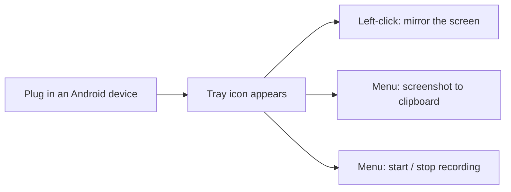

# scrcpy-tray — your Android phone in the Windows tray, the moment you plug it in

[](LICENSE)
[](#requirements)
[](#requirements)
[](https://github.com/Genymobile/scrcpy)

**Click the tray icon to mirror the screen with scrcpy; right-click for a full-resolution screenshot straight to the clipboard.**

Your Android phone appears in the Windows tray the moment you plug it in — no device
connected, no icon, so the tray stays empty until there is actually something to click.

> Not an official Genymobile project, and not affiliated with it. This is a small
> third-party companion that drives [scrcpy](https://github.com/Genymobile/scrcpy)
> and `adb` from the outside.

## Why this exists

scrcpy is a fast, one-shot mirroring tool: you run it, it mirrors, it exits. Two things
sit just outside that scope — launching it automatically when a phone connects, and
taking a single screenshot (scrcpy has no capture flag; mirroring the window and
screenshotting that costs resolution and picks up window chrome). scrcpy-tray covers
both natively on Windows: it watches for the device and pulls screenshots straight off
the phone with `adb exec-out screencap -p` — full device resolution, no window in the
way, straight onto the clipboard.

If you are on Linux or macOS, use [autoadb](https://github.com/rom1v/autoadb) instead —
it is cross-platform and maintained by the author of scrcpy itself.

## What it does

| | |
|---|---|
| **Invisible when idle** | No icon at all while no device is connected |
| **Appears on plug** | Reacts to `WM_DEVICECHANGE`, so it shows up as the device enumerates |
| **Left-click** | Mirror the screen via scrcpy |
| **Screenshot now** | Full-resolution PNG off the device → saved *and* on the clipboard |
| **Record screen** | A toggle: the same menu entry starts it and stops it, showing elapsed seconds while running |
| **Show scrcpy log** | The output scrcpy would have printed to a console — device picked, renderer, texture size |
| **Explains problems** | `unauthorized`, `offline`, `authorizing` and "adb didn't answer" each get their own message instead of silently looking like "no phone" |
| **One instance** | Named mutex, so the startup shortcut plus a manual launch can't give you two icons |

Stopping a recording sends `WM_CLOSE`, the same thing clicking the window's X does, and
only force-kills after that is ignored for 8 seconds — scrcpy writes the MP4 `moov` atom
while shutting down, so a killed recording produces a file no player will open.

Screenshots and recordings go to `<Pictures>\Phone\`, resolved through the real shell
folder — so if your Pictures is OneDrive-redirected, they land where you actually look
and get backed up with everything else.

## Requirements

- Windows 10 or 11
- Windows PowerShell 5.1 (ships with Windows; PowerShell 7 is not supported)
- [scrcpy](https://github.com/Genymobile/scrcpy) and `adb`, installed separately

**Nothing is bundled.** scrcpy and adb are separate projects with their own licences and
release cadence; shipping copies would mean redistributing someone else's binaries and
pinning you to whatever version happened to be current when this was packaged.

```powershell
winget install Genymobile.scrcpy
```

## Install

```powershell
git clone https://github.com/augbastos/scrcpy-tray.git
cd scrcpy-tray
.\install.ps1
```

`install.ps1` finds your scrcpy, creates a Startup shortcut so the tray comes back after
a reboot, and launches it. Run `.\install.ps1 -Uninstall` to undo it.

For the first USB connection, enable **USB debugging** in the phone's **Developer
options**, connect it to the PC, unlock the phone, and accept the USB debugging prompt
to authorise this computer. If the tray shows `unauthorized`, check the phone for that
prompt.

To run it once without installing:

```powershell
wscript.exe scrcpy-tray.vbs
```

### If it can't find scrcpy

It looks, in order: `$env:SCRCPY_HOME`, its own folder, `PATH`, then the usual winget /
scoop / chocolatey locations. If yours lives somewhere unusual:

```powershell
setx SCRCPY_HOME "C:\path\to\scrcpy"
```

`setx` does not update the current shell or a running tray. Open a new PowerShell
session from Start, then rerun `.\install.ps1` to restart the tray with the new value.

**adb is resolved next to scrcpy first, on purpose.** scrcpy ships the adb it was tested
against; picking a different adb off your `PATH` (an Android SDK platform-tools, say) is
what produces `adb server version doesn't match this client` — the first entry in
scrcpy's own FAQ.

## How it works



## Prior art

- **[autoadb](https://github.com/rom1v/autoadb)** by rom1v (scrcpy's author) — runs any
  command on device connect, cross-platform, Rust. The direct ancestor of the idea here.
  scrcpy-tray was written independently; autoadb publishes no licence, so no code from it
  was read or reused.
- **scrcpy issues [#352](https://github.com/Genymobile/scrcpy/issues/352) and
  [#694](https://github.com/Genymobile/scrcpy/issues/694)** — the long-running requests
  for autorun-on-plug that led to autoadb.

## Licence

MIT — see [LICENSE](LICENSE).

scrcpy is Apache-2.0 and belongs to Genymobile; adb is part of the Android SDK
platform-tools. Neither is redistributed here.
